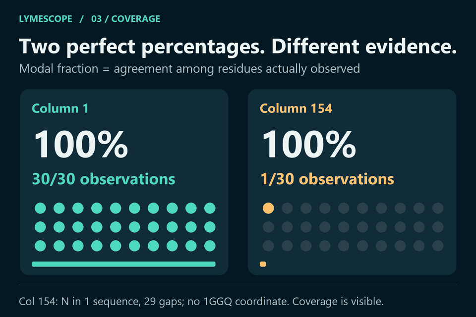
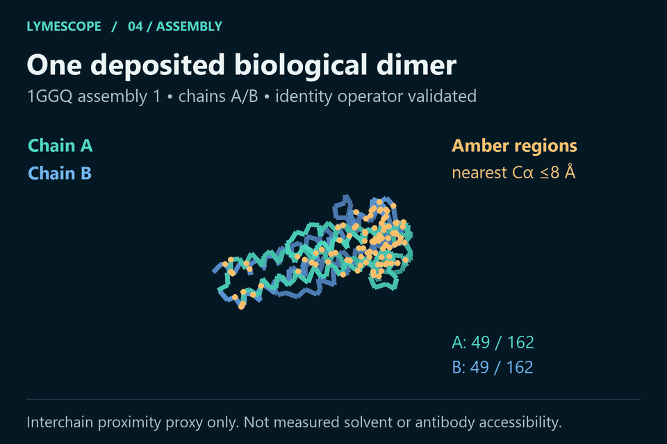
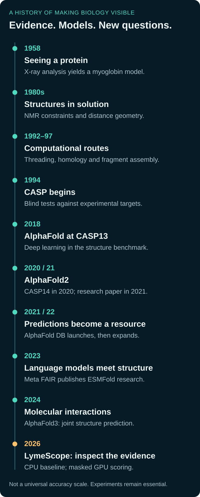

# LYMESCOPE

**Making the invisible biology of Lyme disease explorable.**

Lyme disease is the most common vector-borne disease in the United States. More than 80,000 cases are reported to CDC annually. Insurance-claims analysis estimates approximately 476,000 Americans diagnosed and treated each year; this is not a count of confirmed infections and may overestimate them because billing codes can be inaccurate. Surveillance also has underreporting and classification limitations. [CDC surveillance and estimates](https://www.cdc.gov/lyme/data-research/facts-stats/) · [HHS overview](https://www.hhs.gov/lyme/index.html)

> **Project lead statement - draft awaiting personal approval:** "I want to make complex biological evidence easier to inspect, so researchers can see both what a result supports and what still needs testing."

**Our question:** In a selected, cross-species panel of 30 natural OspC sequences, which aligned positions agree, how many observations support that agreement, and where do those positions map to an experimental structure? A separately prepared ESM-2 extension asks whether observed agreement and masked-residue predictability differ.

**Computed:** a CPU MAFFT alignment, descriptive column statistics and explicit mapping to deposited OspC coordinates. **New integration:** an offline, traceable path from sequence -> alignment -> coverage -> structure, with a separate biological-context presentation and a tested masked-scoring implementation. **For scientists:** inspect denominators and missing coordinates before deciding which differences merit follow-up. **Evidence boundary:** the coordinates come from published X-ray experiments; alignment, agreement and geometric proximity are computational descriptions. Model scores are **not yet measured**. LymeScope provides no diagnosis, clinical recommendation, protective-antigen discovery or safety assessment.

[Open the offline demo](demo/v0.2.0/index.html) · [Frozen results viewer](sparkprep/analysis/ospc_comparison_v0.1.0/results_v0.1.0/index.html) · [One-page submission](submission/ONE_PAGER.md) · [Five-minute script](submission/DEMO_SCRIPT.md)

Download/clone the repository, then open the HTML locally. GitHub's file view shows HTML source; no hosted demo is implied. No model, server or network connection is needed for the saved-results demonstration. [Local instructions](RUN_LOCALLY.md)

## Start with the denominator

<picture><source media="(prefers-reduced-motion: reduce)" srcset="demo/v0.2.0/assets/coverage-evidence.png"></picture>

**Actual saved statistics, animated originally for this project.** Column 1 is identical at 30/30 coverage. Column 154 contains one observed N and 29 gaps. Column 173 similarly has one observed G. The percentage is correctly calculated from one observation; that is insufficient support for broad conservation in this panel. Both sparse columns are reference gaps and receive no invented 3D coordinates. [Static alternative](demo/v0.2.0/assets/coverage-evidence.png) · [Saved methods](sparkprep/analysis/ospc_comparison_v0.1.0/results_v0.1.0/METHOD_AND_LIMITATIONS.md)

| Population | Count | Meaning |
|---|---:|---|
| Selected natural sequences | 30 | Convenience panel; not all Lyme-associated diversity |
| Fixed alignment columns | 218 | 202 fully covered; 16 with gaps |
| F: fully covered columns | 202 | Primary comparison population |
| Identical within F | 76 | Agreement within this selected panel |
| M: mapped, observed 1GGQ residues | 162 | Experimental chain-A coordinates available |
| MF: F intersection M | 159 | Full coverage and observed coordinates |
| M minus F | 3 | Columns 75, 86, 119; descriptive scores require denominators |

## From letters to an experimental protein

OspC is a bacterial surface protein studied in Lyme disease. We use the deposited 1GGQ structure, not an AI-generated fold. The original analysis maps 162 observed chain-A residues; 11 corresponding residues lack coordinates. Construct boundaries and reference gaps remain explicit. [Kumaran et al., 2001](https://doi.org/10.1093/emboj/20.5.971)

<picture><source media="(prefers-reduced-motion: reduce)" srcset="demo/v0.2.0/assets/ospc-rotation.png"></picture>

**Experimental-coordinate rendering.** This original C-alpha trace uses a rotating camera, not folding, dynamics, a molecular surface or a new structure prediction. [Static alternative](demo/v0.2.0/assets/ospc-rotation.png) · [PDB 1GGQ](https://www.rcsb.org/structure/1GGQ)

<picture><source media="(prefers-reduced-motion: reduce)" srcset="demo/v0.2.0/assets/alignment-map.png"></picture>

**Saved alignment, presentation transition.** The display collapses rows visually without realigning or renumbering columns. Amber bars show observed modal fractions; teal bars show coverage. [Static alternative](demo/v0.2.0/assets/alignment-map.png) · [Frozen alignment](sparkprep/analysis/ospc_comparison_v0.1.0/results_v0.1.0/aligned.fasta)

<strong>Explore the dimer, an exact residue correspondence and the proposed compute workflow</strong>

**Deposited assembly + computational proxy.** Assembly 1 is the author/software-supported A/B dimer with an identity operator. Amber marks residues whose nearest other-chain C-alpha is at most 8 angstroms (49/162 per chain). This is a contact proxy, not measured solvent or antibody accessibility or a binding-site discovery. [Static alternative](demo/v0.2.0/assets/ospc-dimer.png) · [Checked assembly and mapping](demo/v0.2.0/context.json) · [Original paper](https://doi.org/10.1093/emboj/20.5.971)

**Explicit saved correspondence.** Alignment column 68 -> Q07337 position 67 -> observed 1GGQ A Ser67. [Static alternative](demo/v0.2.0/assets/residue-mapping.png) · [Frozen mapping](sparkprep/analysis/ospc_comparison_v0.1.0/results_v0.1.0/alignment_to_structure.tsv)

**Conceptual, unexecuted workflow.** Whole-sequence shards preserve the same 6,305 examples and batching protocol. Dots illustrate task distribution; they encode no timing, bandwidth or speedup. [Static alternative](demo/v0.2.0/assets/task-shards.png) · [Locked workload](sparkprep/analysis/ospc_masked_v0.2.0/plans/workload.json)

All six assets are original renders from saved data or explicitly conceptual diagrams. [Asset inventory, dimensions, sizes and hashes](demo/v0.2.0/assets/manifest.json). The offline demo defaults to static previews with deliberate play/stop controls.

## What local AI supercomputing contributes

The completed biological baseline ran on the personal DGX Spark CPU. Separate event evidence demonstrates CIQ Fuzzball scheduling of a real PyTorch CUDA calculation on NVIDIA GB10 at Spark30, plus persistent Team 15 storage and reads of identical saved bytes on Spark29 and Spark30. These are infrastructure results, not scientific acceleration. [Saved event receipts](findings/phase-b-results.json) · [Infrastructure viewer](portable_results/index.html)

The prepared extension uses **Meta FAIR's ESM-2 8M** to score the original amino acid after masking exactly that residue. It preserves sequence identity, offsets, alignment mapping and contributor counts. Full-coverage columns define the primary agreement/NLL comparison. Leave-out analyses reuse per-sequence scores. The exact input needs **6,305 masked examples / 415 scoring forwards** at per-sequence batch size 16. Pilot and warm-up calls are separate.

| Evidence | Current state |
|---|---|
| Frozen CPU alignment, statistics and reference mapping | Completed |
| CUDA calculation and two-node shared-storage read | Completed infrastructure proof |
| Offline scorer, ingestion and sensitivity tests | Passed fixtures; not real inference |
| ESM-2 masked scores and real-model pilot | **Not yet measured** |
| Matched one-node / two-node scientific benchmark | **Not run; no speedup claim** |

[Scoring contract and implementation](sparkprep/analysis/ospc_masked_v0.2.0/README.md) · [Bounded model-staging request](sparkprep/analysis/ospc_masked_v0.2.0/STAGING_REQUEST.md) · [Claim verification](submission/CLAIM_VERIFICATION.md)

## A history of making biology visible

| Era | Milestone and primary source |
|---|---|
| 1958 | Experimental X-ray myoglobin model: [Kendrew et al.](https://www.nature.com/articles/181662a0) |
| 1980s | NMR constraints and distance geometry for solution conformations: [Havel & Wuthrich, 1985](https://pubmed.ncbi.nlm.nih.gov/2582141/) |
| 1992-97 | Computational routes include [threading](https://www.nature.com/articles/358086a0), [comparative/homology modeling](https://doi.org/10.1006/jmbi.1993.1626) and [fragment-based ab initio assembly](https://pubmed.ncbi.nlm.nih.gov/9149153/). These are examples, not claims of first invention. |
| 1994 | CASP starts blind assessments: [EMBL-EBI](https://www.ebi.ac.uk/training/online/courses/alphafold/validation-and-impact/how-have-alphafolds-predictions-of-protein-structure-been-validated/) |
| 2018 | AlphaFold enters CASP13: [DeepMind chronology](https://deepmind.google/science/alphafold/) |
| 2020 / 2021 | AlphaFold2 at CASP14; research publication the following year: [Jumper et al.](https://www.nature.com/articles/s41586-021-03819-2) |
| 2021 / 2022 | AlphaFold DB launches and expands to over 200 million predicted structures: [EMBL-EBI](https://www.ebi.ac.uk/about/news/technology-and-innovation/alphafold-200-million/) |
| 2023 | Meta FAIR/Meta AI publishes ESMFold and large-scale protein-language-model research: [Lin et al.](https://pubmed.ncbi.nlm.nih.gov/36927031/) |
| 2024 | AlphaFold3 predicts joint biomolecular structures, including interactions: [Abramson et al.](https://www.nature.com/articles/s41586-024-07487-w) |
| 2026 | LymeScope integrates existing evidence into an accessible local workflow; CPU OspC baseline complete, model scoring pending. |

Prediction does not replace experiments. No universal "40-60% accuracy" scale or cross-era performance percentage is used. ESMFold history is context: LymeScope's pending scorer is **ESM-2**, not ESMFold.

## A credible future for digitized biology

Computational protein research may help formulate and test ideas for medicines, targeted biological sensing, drug delivery, biomanufacturing, environmental remediation, pandemic preparedness, and molecular interactions relevant to cancer or neurodegenerative disease. These possibilities span different methods and experiments; they are not capabilities delivered by this OspC atlas. Structure prediction and open resources can support hypotheses; function, delivery, specificity and safety require their own validation. [EMBL-EBI research context](https://www.ebi.ac.uk/about/news/technology-and-innovation/alphafold-200-million/) · [Interaction-model research](https://www.nature.com/articles/s41586-024-07487-w)

LymeScope's contribution today is narrower and inspectable: connect an observation to its supporting sequences, coordinates, sources and limitations.

## Reproduce, review, present

- [Submission checklist](submission/SUBMISSION_CHECKLIST.md), [one-pager](submission/ONE_PAGER.md), [4:30 narration + 30-second buffer](submission/DEMO_SCRIPT.md).
- [Sources and attribution](submission/SOURCE_REFERENCES.md), [claims and evidence](submission/CLAIM_VERIFICATION.md), [validation receipt](submission/validation.json).
- Frozen inputs, outputs and manifests remain at [v0.1.0](sparkprep/analysis/ospc_comparison_v0.1.0/results_v0.1.0/). New presentation/scorer code uses v0.2.0. Historical receipts are preserved.
- Model weights are excluded. Downloads, execution and main publication need separate approval. No project license is invented; public visibility is not third-party redistribution permission.
- Submission: **November 15, 2026, noon Central**. Live demo: **1:00 PM**, five minutes maximum. Research cutoff: **10:30 AM Central**. The submission stands on completed CPU evidence regardless of later GPU results.
