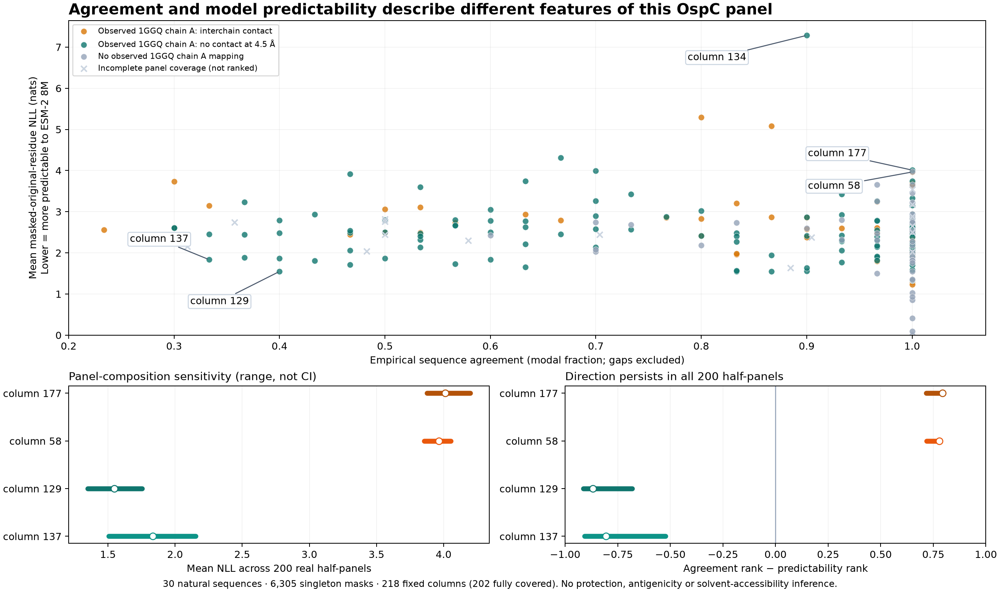
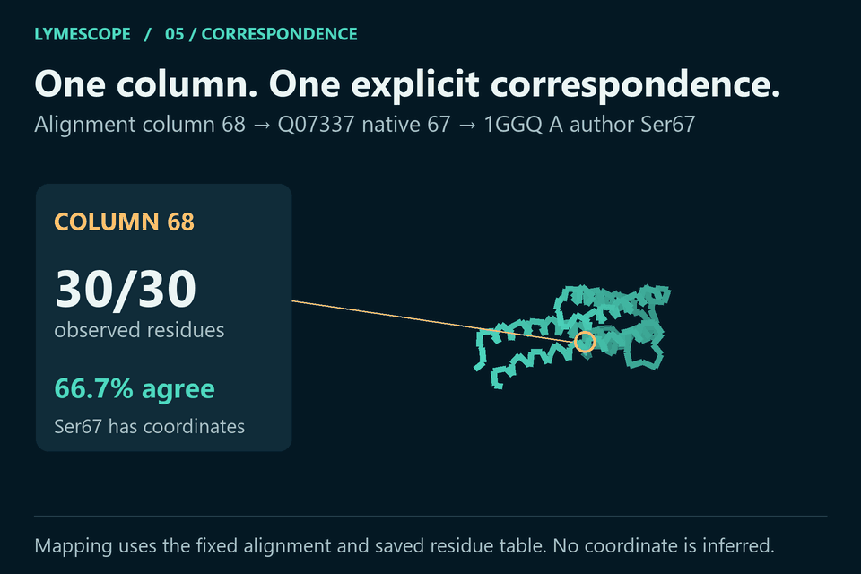
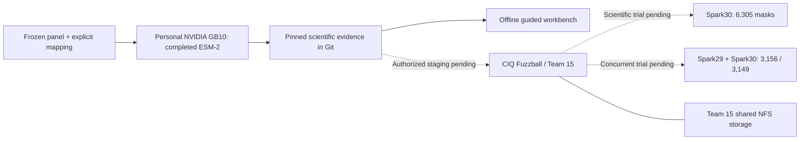

# LYMESCOPE
**Making the invisible biology of Lyme disease explorable.**

More than **80,000 Lyme cases are reported to CDC each year**. A separate claims-based estimate suggests **476,000 people are diagnosed and treated**; these are different measures, with different limitations. [CDC](https://www.cdc.gov/lyme/data-research/facts-stats/) · [Evidence C01](docs/claim-index.md#c01)

**Question:** Within 30 selected natural OspC sequences, does empirical sequence agreement track a protein language model’s ability to predict each original residue? **Result:** A completed personal-GB10 experiment scored 6,305 singleton masks and found weak descriptive agreement–predictability correlation across 202 fully covered columns (Spearman rho **0.134696**). **Limit:** This selected-panel result does not establish immune protection, antibody accessibility, a vaccine target or clinical utility. [C02](docs/claim-index.md#c02) · [C04](docs/claim-index.md#c04) · [C07](docs/claim-index.md#c07)



*Original saved scientific output. Lower NLL means more predictable under the pinned checkpoint. Incomplete columns remain visible and are excluded from full-coverage ranks. [Full-size SVG](sparkprep/experiments/stretch_v0.2.0_20261115T072916Z/results/full_panel_agreement_predictability.svg) · [Exact data](sparkprep/experiments/stretch_v0.2.0_20261115T072916Z/results/full_panel_comparison_v2/column_comparison.tsv).*

## Open the evidence workbench

**[Guided workbench: `docs/index.html`](docs/index.html)** · [Original demo](demo/v0.2.0/index.html) · [Frozen v0.1.0 viewer](sparkprep/analysis/ospc_comparison_v0.1.0/results_v0.1.0/index.html)

Open the HTML after downloading/cloning this feature branch. The workbench is zero-build, with embedded data and local assets: no model, server, package installation or network is needed. **GitHub’s file view shows source; GitHub Pages hosting is prepared, not claimed live.** [Local instructions](RUN_LOCALLY.md) · [Pages preparation](docs/PAGES_PREPARATION.md)

```text
git clone --branch feature/ospc-masked-scoring-v0.2.0 https://github.com/francolinx/LymeScope.git
# Then open LymeScope/docs/index.html in a browser.
```

| Guided story | Inspect | Evidence boundary |
|---|---|---|
| **1 · The coverage trap** | Column 154: 100% modal agreement, **1/30** observations | One observation cannot support broad conservation |
| **2 · The model disagreement** | Column 177: G:30, NLL **4.01135**; column 129: mixed residues, NLL **1.54783** | NLL measures conditional predictability, not conservation or immunogenicity |
| **3 · The homodimer** | Experimental 1GGQ A/B; verified contacts and separate calculated SASA | Static geometry is not physiological antibody accessibility |
| **4 · What experiments add** | Published B11/9BIF, B5/7UIJ and 8C1 evidence | Antibody mapping stays pending until independently validated |

[C03](docs/claim-index.md#c03) · [C08](docs/claim-index.md#c08) · [C09–C12](docs/claim-index.md#c09) · [Independent evidence C15](docs/claim-index.md#c15)

## From experimental structure to local scientific AI

X-ray/NMR → homology, threading and ab initio methods → CASP blind assessment → AlphaFold → protein language models → local, inspectable evidence analysis. These approaches answer different questions; there is no universal historical accuracy percentage. [Primary-source timeline](submission/SOURCE_REFERENCES.md#timeline-sources) · [Accessible original timeline](demo/v0.2.0/assets/biology-timeline.svg)

LymeScope uses **ESM-2 for residue scoring** and **existing experimental PDB structures for coordinates**. ESMFold and AlphaFold are historical context, not the source of these OspC coordinates. [C06](docs/claim-index.md#c06) · [C11](docs/claim-index.md#c11)

<details>
<summary><strong>Three original scientific animations — with static alternatives</strong></summary>

<picture><source media="(prefers-reduced-motion: reduce)" srcset="demo/v0.2.0/assets/ospc-dimer.png"></picture>

**The actual homodimer.** Teal/blue show the deposited partners; amber is the legacy **8 Å Cα proximity proxy**, distinct from the current **4.5 Å heavy-atom contact** field. Rotation is camera motion, not folding or dynamics. [Static](demo/v0.2.0/assets/ospc-dimer.png).

<picture><source media="(prefers-reduced-motion: reduce)" srcset="demo/v0.2.0/assets/residue-mapping.png"></picture>

**An explicit sequence-to-structure map.** Column 68 → Q07337 position 67 → 1GGQ A Ser67. Coverage and agreement travel with the correspondence. [Static](demo/v0.2.0/assets/residue-mapping.png).

<picture><source media="(prefers-reduced-motion: reduce)" srcset="demo/v0.2.0/assets/coverage-evidence.png"></picture>

**The coverage trap.** The percentage is correctly calculated from one observation; that is insufficient support for broad conservation in this panel. [Static](demo/v0.2.0/assets/coverage-evidence.png).

Original asset hashes, frame counts and sources: [manifest](demo/v0.2.0/assets/manifest.json), [C16](docs/claim-index.md#c16). The interactive workbench starts with static images and offers deliberate play/stop controls. Browser playback is a separate validation step.
</details>

## What was measured

| Evidence | Recorded result | Scope |
|---|---|---|
| Frozen natural panel | 30 sequences; 218 alignment columns | Selected, related sequences; fixed alignment |
| Analysis sets | **F 202**, **M 162**, **MF 159** | Fully covered, observed mapped, intersection; M minus F = 75/86/119 |
| Personal-Spark ESM-2 | **6,305 masks / 805 scoring calls** at batch 8 | Original residues; three warm-up calls / 24 examples separate |
| Warm GPU scoring | **9.909294 s** on personal GB10 | Model load + transfer **0.313129 s** |
| Process wall | **10.510127 s after imports** | Not complete launch-to-result workflow time |
| Sensitivity | **239** overlapping subsets | 30 leave-one-out, 200 half-panels, nine metadata-group omissions; zero additional model calls |
| 1GGQ dimer geometry | **118** contact pairs; **51** residues/partner at ≤4.5 Å | OspC–OspC contacts, not antibody contacts |
| Calculated SASA loss | **4,081.16 Ų** total; **2,040.58 Ų** mean partner interface | 1.40 Šprobe; 1,920 points/atom; static incomplete construct |
| Matched event scientific benchmark | **NOT RUN** | No measured one-node/two-node speedup |

[C02](docs/claim-index.md#c02) · [C04–C05](docs/claim-index.md#c04) · [C07](docs/claim-index.md#c07) · [C09–C10](docs/claim-index.md#c09) · [Original SASA figure](sparkprep/experiments/stretch_v0.2.0_20261115T072916Z/results/calculated_sasa_dimer_context.svg)

**Unknown is a data state.** Unobserved/unmapped contact and SASA values stay null, distinct from observed false and calculated zero. The current aggregate is **`full_panel_comparison_v2`**. [C12](docs/claim-index.md#c12)

## CIQ / NVIDIA / VAST event architecture



Saved event receipts demonstrate a real CUDA calculation on Spark30 and identical shared-storage bytes read on Spark29 and Spark30. They establish infrastructure, not scientific scaling. **VAST backend identity remains UNVERIFIED.** The saved provisioner is NFS; current CLI reads timed out, and NFS alone does not identify its storage vendor. The [scientific shared-storage plan](workflows/ospc-spark-v0.2.1/VAST_STORAGE_PLAN.md) reuses the existing 1 GiB volume, with exact object-cache ingress, one shared model copy and separate output shards—all **PLANNED**. [VAST evidence and blockers](submission/VAST_EVIDENCE.md) · [Receipts / C13](docs/claim-index.md#c13)

The morning trial reuses the exact batch-8 scorer and existing six-file model cache. Independent GPU task shards are **not** NCCL/RDMA or distributed-model capacity. Physical-node attribution, runtime/pilot checks, exact task coverage, fixed numerical tolerance and complete coordinator makespan are acceptance gates. [Morning runbook](docs/MORNING_RUNBOOK.md) · [Exact venue contract](workflows/ospc-spark-v0.2.1/VENUE_HANDOFF.md) · [C14](docs/claim-index.md#c14)

## Challenge, reproduce, inspect

- **Start here:** [claim index](docs/claim-index.md) / [machine-readable JSON](docs/claim-index.json), [methods and limits](sparkprep/experiments/stretch_v0.2.0_20261115T072916Z/SCIENCE_FINDINGS.md), [raw 6,305 scores](sparkprep/experiments/stretch_v0.2.0_20261115T072916Z/results/full_panel_v1/residue_nll.tsv).
- **Exact source:** personal-Spark commit [`aafe818a20ea025370cf4b65145a9684e80aaaef`](https://github.com/francolinx/LymeScope/commit/aafe818a20ea025370cf4b65145a9684e80aaaef); frozen baseline `8058846c05d4dccd60117dd29ef784af43570418`. Raw-score SHA256: `b27d926285a8dc338abceba953229089be4f35fcba7c166c1a922be146a6317f`.
- **Model:** `facebook/esm2_t6_8M_UR50D`, revision `c731040fcd8d73dceaa04b0a8e6329b345b0f5df`; eval/inference, float32, eager attention, full-vocabulary log-softmax. Full natural sequences, with exact accession/position/sequence-hash provenance. [C06](docs/claim-index.md#c06).
- **Validation:** [published 16-test Spark receipt](sparkprep/experiments/stretch_v0.2.0_20261115T072916Z/provenance/tests_full_release.log), [laptop integration checks](submission/spark-integration-validation.json), [frontier sprint checks](submission/frontier-validation.json). Offline fixtures are distinct from actual inference; browser rendering is not inferred from tests.
- **Attribution:** [primary sources and terms](submission/SOURCE_REFERENCES.md). No project license is invented; public visibility does not grant redistribution rights to third-party material.

## The next falsifiable question

Does disagreement between empirical agreement and model predictability add information about **experimentally observed antibody-interaction regions**, beyond amino-acid identity, ordinary conservation and structural geometry? The next comparison must preserve construct coverage, map numbering explicitly, distinguish antibody contacts from homodimer contacts, and retain negative or inconclusive outcomes. [B11 / 9BIF](https://www.rcsb.org/structure/9BIF) · [B5 / 7UIJ](https://www.rcsb.org/structure/7UIJ) · [8C1 primary study](https://doi.org/10.1128/spectrum.02883-24)

The educational evidence card is source-verified; a new residue-level antibody overlay is **pending validated Spark output**. No sequence design, clinical recommendation or immune-protection prediction is delivered here. [C15](docs/claim-index.md#c15)

**Submission:** [one-page summary](submission/ONE_PAGER.md) · [five-minute demo](submission/DEMO_SCRIPT.md) · [checklist](submission/SUBMISSION_CHECKLIST.md). November 15: research cutoff **10:30 AM Central**, submission **noon**, live demo **1:00 PM**. The completed personal-Spark result and offline fallback do not depend on a venue GPU run.

Project lead statement remains **draft awaiting personal approval**; organizer eligibility and submission-route confirmation are tracked in the checklist. Main and hosting settings require separate approval.
