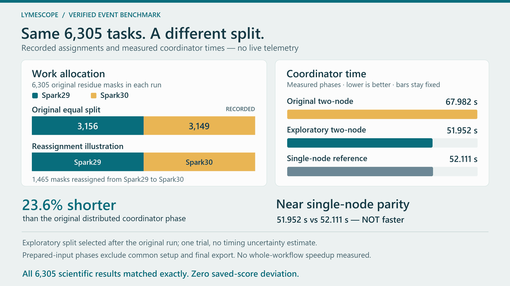
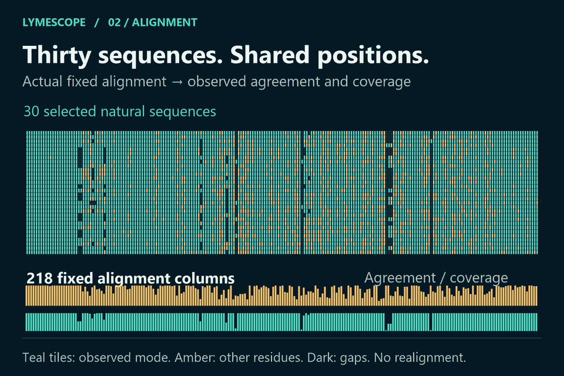
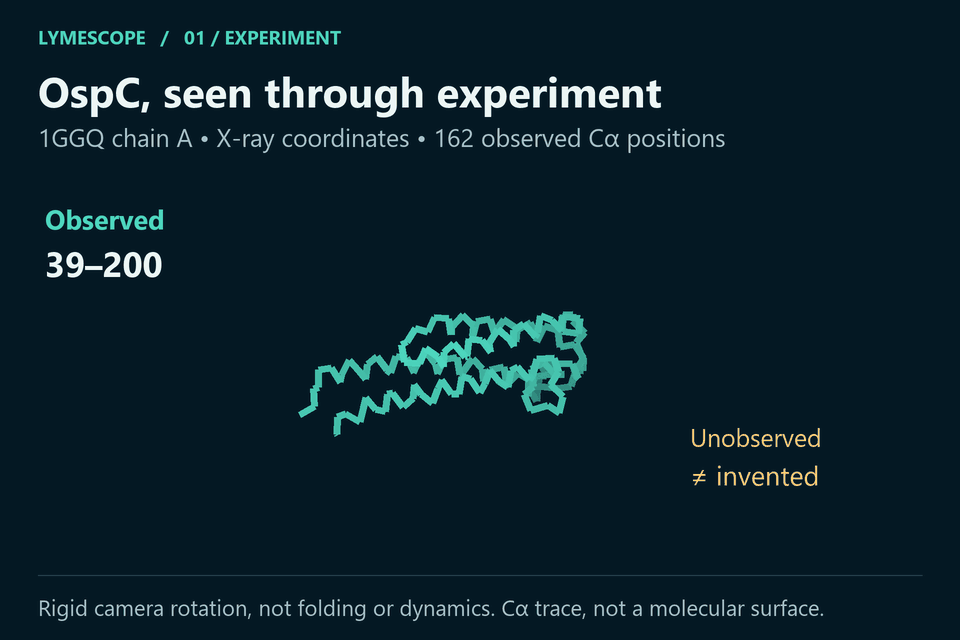
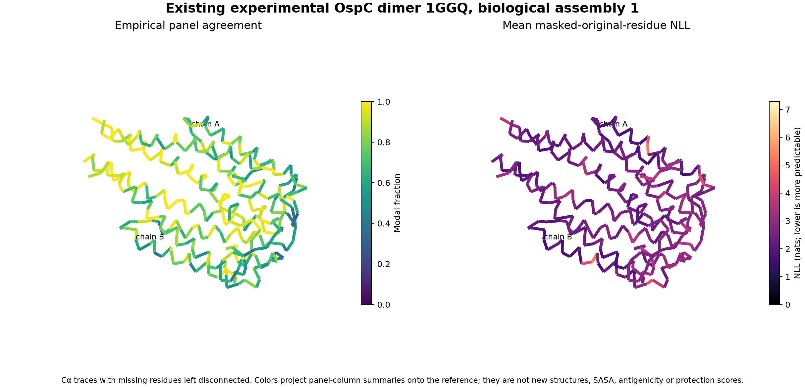
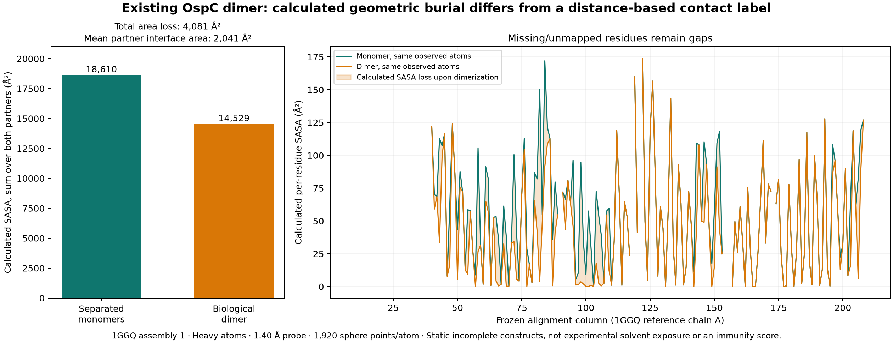
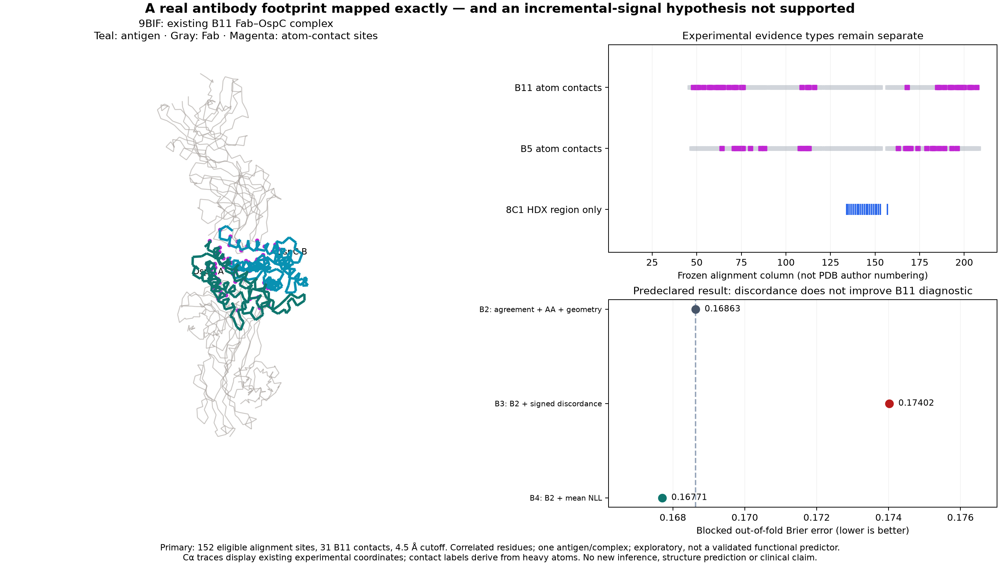
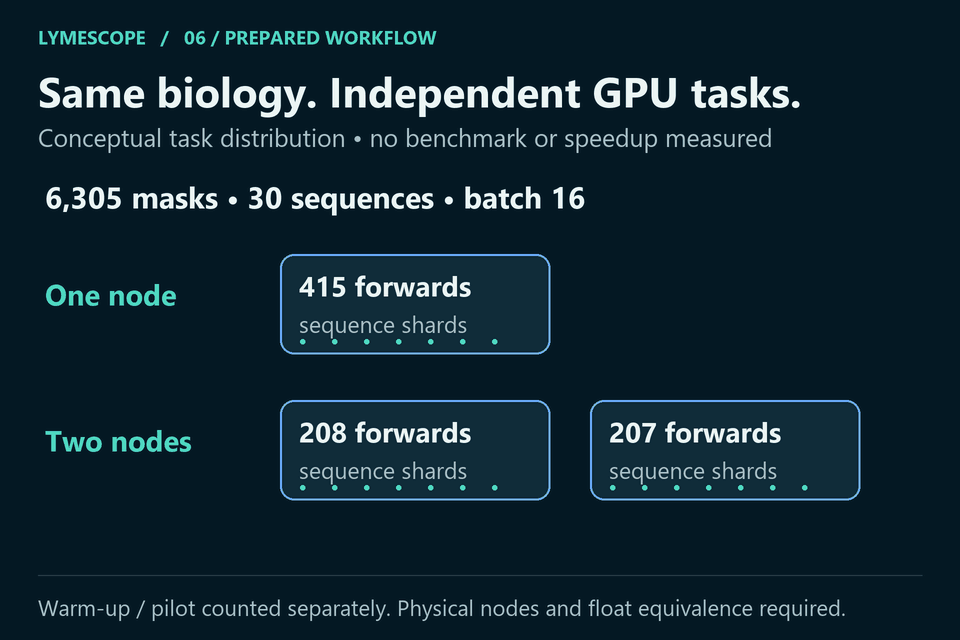
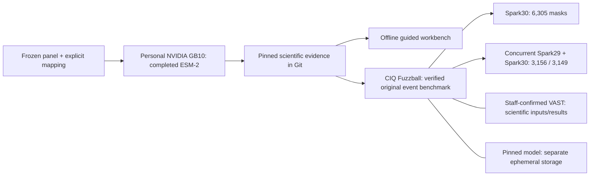

# LYMESCOPE
**Making the invisible biology of Lyme disease explorable.**

More than **80,000 Lyme cases are reported to CDC each year**. A separate claims-based estimate suggests **476,000 people are diagnosed and treated**; these are different measures, with different limitations. [CDC](https://www.cdc.gov/lyme/data-research/facts-stats/) · [Evidence C01](docs/claim-index.md#c01)

LymeScope focuses on **OspC, outer surface protein C**, a Borrelia surface antigen with experimentally studied structures and antibody interactions. Its purpose is to let researchers challenge a seemingly convincing residue score by tracing it to observations, model assumptions and coordinates. [Experimental OspC structure](https://doi.org/10.1093/emboj/20.5.971) · [B11–OspC study](https://doi.org/10.4049/jimmunol.2400247)

**Question:** Within 30 selected natural OspC sequences, does empirical sequence agreement track a protein language model’s ability to predict each original residue? **Result:** A completed personal-GB10 experiment scored 6,305 singleton masks and found weak descriptive agreement–predictability correlation across 202 fully covered columns (Spearman rho **0.134696**). **Limit:** This selected-panel result does not establish immune protection, antibody accessibility, a vaccine target or clinical utility. [C02](docs/claim-index.md#c02) · [C04](docs/claim-index.md#c04) · [C07](docs/claim-index.md#c07)

<picture><source media="(prefers-reduced-motion: reduce)" srcset="demo/v0.2.0/assets/ospc-dimer.png"></picture>

**Start with the real molecule.** Deposited experimental 1GGQ chains A/B, with rigid camera rotation—not a predicted fold or molecular dynamics. Amber is the **8 Å Cα proximity proxy**, distinct from the **4.5 Å heavy-atom contacts** and calculated SASA below. [Static image](demo/v0.2.0/assets/ospc-dimer.png) · [Experimental source](https://www.rcsb.org/structure/1GGQ) · [Geometry and limits](docs/claim-index.md#c09)

**This page is the complete scientific presentation.** Read the findings, visuals, methods and limits below without leaving GitHub. The [optional interactive workbench](docs/index.html), [one-page summary](submission/ONE_PAGER.md) and [claim index](docs/claim-index.md) provide deeper inspection. Pages is not live yet.

*Original saved scientific output. Lower NLL means more predictable under the pinned checkpoint. Incomplete columns remain visible and are excluded from full-coverage ranks. [Full-size SVG](sparkprep/experiments/stretch_v0.2.0_20261115T072916Z/results/full_panel_agreement_predictability.svg) · [Exact data](sparkprep/experiments/stretch_v0.2.0_20261115T072916Z/results/full_panel_comparison_v2/column_comparison.tsv).*

## Verified event results — November 15, 2026

**The first validated full event benchmark completed at 10:43:33 AM Central on physical Spark29 and Spark30 NVIDIA GB10s.** All **6,305 original scientific tasks** completed exactly once, with **zero saved-score deviation** from the frozen reference and **16.233 seconds of overlapping scoring**.

The two-node workload reproduced all 6,305 scientific evaluations exactly, but took longer than the single-node baseline in this measurement.

| Measured scope | One node: Spark30 | Two nodes: Spark29 + Spark30 |
|---|---:|---:|
| Warm scoring wall time | **30.224031 s** | **42.397251 s** (maximum shard) |
| Spark29 shard warm scoring | — | **42.397251 s** |
| Spark30 shard warm scoring | — | **16.233051 s** |
| Prepared-input coordinator makespan | **52.110527 s** | **67.982290 s** |
| Original tasks / scoring forwards | 6,305 / 805 | 3,156 + 3,149 / 403 + 402 |

**Negative scaling: two nodes took 30.5% longer.** The single/two coordinator time ratio was **0.767×**, below parity; no acceleration is claimed. Both phases shared one workflow and prepared inputs, with both workers reserved and Spark29 idle during the single-node phase. Coordinator timings include startup, model loading, scoring, output writing, readback/validation and the two-node merge; common staging and final export are excluded. Separate cold-launch workflow comparisons were not measured. Node asymmetry and timing variance remain unresolved.

All **25 exported artifacts** passed independent hash/readback verification. **VAST backing was confirmed onsite**, and actual scientific persistence was verified; no storage-throughput claim is made. The original biology, pinned model and negative B11 result below are unchanged.

[Sanitized event report](submission/venue_secondnode_v1/SPRINT_RESULT.md) · [Exact acceptance data](submission/venue_secondnode_v1/RESULT.json) · [Completed workflow receipt](submission/venue_secondnode_v1/WORKFLOW_RECEIPT.json) · [Readback and publication provenance](submission/venue_secondnode_v1/PUBLICATION_PROVENANCE.json) · [Completed demo insert](submission/venue_secondnode_v1/DEMO_INSERT.md) · [Offline display with timing bars (HTML source)](demo/venue-secondnode-v1/index.html). The HTML runs from a local checkout; this link is not a hosted web app. This release covers only workflow `79319e56-f368-4eba-8cae-7c646737b9fc` and its preserved pilot evidence, not subsequent optimization.

### Watch the two-node optimization

**The animation shows the first exploratory experiment, not the newer confirmation pair.**

**First experiment (shown):** Spark29/Spark30 work changed from **3,156 / 3,149** to **1,691 / 4,614 masks**. Coordinator time fell from **67.982 to 51.952 s: 23.6% shorter**, near parity with its **52.111 s single-node reference**, not demonstrated single-node acceleration. The split was selected after the original run. All **6,305 scientific scores matched exactly**, with zero numerical deviation. Only the allocation transition is illustrative; measured timing bars stay fixed.

**Newer confirmation (reported separately below):** **54.568 s single node versus 50.039 s optimized two nodes**, **8.3% shorter / approximately 1.091×** in one preliminary comparison pair. Both comparisons concern prepared-input coordinator phases, excluding common staging and final export; no full cold-launch speedup was established.

[Static PNG fallback](demo/benchmark-comparison-v1/benchmark-comparison.png) · [First exploratory receipt](submission/venue_frontier_v1/RESULT.json) · [Fresh confirmation and limitations](submission/venue_confirmation_v1/FINAL_CONFIRMATION.md) · [Animation provenance](submission/benchmark_animation_v1/PROVENANCE.json).

## Separate exploratory workload-placement result

After the original negative-scaling result above, one post-hoc whole-sequence reassignment preserved the same 6,305 natural tasks, pinned model, batch 8 and float32/eager method. All scores again matched the frozen reference and original event single-node output with zero maximum absolute and relative deviation.

| Prepared-input coordinator phase | Time |
|---|---:|
| Original single node | 52.111 s |
| Original equal-count two nodes | 67.982 s |
| One exploratory throughput-informed split | 51.952 s |

The exploratory phase was **23.6% shorter than the original two-node phase**. Its 0.3% difference from single node is **near parity, not established acceleration**. Spark29 handled 1,691 masks/216 calls and Spark30 4,614 masks/589 calls; scoring overlapped for 22.707 seconds. This is one post-hoc trial, with diagnostic sampling added only in that trial. Common setup and final export are excluded; whole-workflow speedup was not measured. The cause of the historical node asymmetry remains unresolved.

[Findings and limitations](submission/venue_frontier_v1/FRONTIER_RESULT.md) · [Exact acceptance](submission/venue_frontier_v1/RESULT.json) · [Offline comparison (HTML source)](demo/venue-frontier-v1/index.html) · [Final one-page PDF](output/pdf/LYMESCOPE_FRONTIER_VERIFIED_20261115.pdf). Public metadata extracts omit operational paths and GPU identifiers; [publication provenance](submission/venue_frontier_v1/PUBLICATION_PROVENANCE.json) maps original readback hashes to sanitized public bytes. The later confirmation is reported separately below.

## One fresh confirmation pair

The unchanged previously selected partition was checked once more against a fresh full Spark30 run. Prepared-input coordinator phases measured **54.568 s single node and 50.039 s two nodes: 8.3% lower / 1.091x in this pair**. All 6,305 tasks appeared exactly once in both outputs, with zero maximum absolute/relative score deviation; physical Spark29/Spark30 scoring overlapped for 20.765 s. Twenty-four exports passed hash readback.

The original equal-count configuration was not repeated. The partition was selected post hoc; single-node science preceded two-node science in fixed order, with both workers reserved. These phases exclude common setup/export and do not establish cold-launch or general scaling. The two optimized phase observations (51.952 and 50.039 s) are reported separately. [Confirmation findings](submission/venue_confirmation_v1/FINAL_CONFIRMATION.md) · [Exact acceptance](submission/venue_confirmation_v1/RESULT.json) · [Sanitized public provenance](submission/venue_confirmation_v1/PUBLICATION_PROVENANCE.json). The protected PDF/ZIP predate this confirmation and remain valid for their stated earlier scope.

## How to read the evidence

| Label | Meaning here |
|---|---|
| **MEASURED** | Recorded execution or observation, with its hardware and timing scope stated |
| **VERIFIED EXPERIMENTAL STRUCTURE** | Pre-existing deposited coordinates with checked assembly and sequence correspondence |
| **CALCULATED** | A reproducible statistic or geometric quantity derived from saved data |
| **EXPLORATORY** | A descriptive or held-region diagnostic with limited generalizability; not functional validation |
| **PLANNED** | A prepared workflow or research proposal, not a completed measurement |
| **NOT RUN** | No result exists for that execution; a placeholder is not evidence |

**UNVERIFIED** marks an unresolved observation, such as the cause of the measured node-performance asymmetry. A result may be measured on a personal Spark while its biological interpretation remains exploratory.

| Guided story | Inspect | Evidence boundary |
|---|---|---|
| **1 · The coverage trap** | Column 154: 100% modal agreement, **1/30** observations | One observation cannot support broad conservation |
| **2 · The model disagreement** | Column 177: G:30, NLL **4.01135**; column 129: mixed residues, NLL **1.54783** | NLL measures conditional predictability, not conservation or immunogenicity |
| **3 · The homodimer** | Experimental 1GGQ A/B; verified contacts and separate calculated SASA | Static geometry is not physiological antibody accessibility |
| **4 · What experiments add** | Verified B11 footprint and a **negative** predeclared diagnostic; supporting B5 context | No incremental predictive value demonstrated; 8C1 remains literature-only |

[C03](docs/claim-index.md#c03) · [C08](docs/claim-index.md#c08) · [C09–C12](docs/claim-index.md#c09) · [Independent evidence C15](docs/claim-index.md#c15)

## What was measured

| Evidence | Recorded result | Scope |
|---|---|---|
| Frozen natural panel | 30 sequences; 218 alignment columns | Selected, related sequences; fixed alignment |
| Analysis sets | **F 202**, **M 162**, **MF 159** | Fully covered, observed mapped, intersection; M minus F = 75/86/119 |
| Personal-Spark ESM-2 | **6,305 masks / 805 scoring calls** at batch 8 | Original residues; three warm-up calls / 24 examples separate |
| Warm GPU scoring | **9.909294 s** on personal GB10 | Model load + transfer **0.313129 s** |
| Process wall | **10.510127 s after imports** | Not complete launch-to-result workflow time |
| Sensitivity | **239** overlapping subsets | 30 leave-one-out, 200 half-panels, nine metadata-group omissions; zero additional model calls |
| 1GGQ dimer geometry | **118** contact pairs; **51** residues/partner at ≤4.5 Å | OspC–OspC contacts, not antibody contacts |
| Calculated SASA loss | **4,081.16 Ų** total; **2,040.58 Ų** mean partner interface | 1.40 Šprobe; 1,920 points/atom; static incomplete construct |
| Matched event scientific benchmark | **VERIFIED: exact reproduction, negative scaling** | 52.111 s one node / 67.982 s two nodes; prepared-input phases |

[C02](docs/claim-index.md#c02) · [C04–C05](docs/claim-index.md#c04) · [C07](docs/claim-index.md#c07) · [C09–C10](docs/claim-index.md#c09) · [Original SASA figure](sparkprep/experiments/stretch_v0.2.0_20261115T072916Z/results/calculated_sasa_dimer_context.svg)

**Unknown is a data state.** Unobserved/unmapped contact and SASA values stay null, distinct from observed false and calculated zero. The current aggregate is **`full_panel_comparison_v2`**. [C12](docs/claim-index.md#c12)

**EXPLORATORY · The measurements can disagree.** Empirical modal agreement counts the most common observed residue. Masked NLL measures the probability assigned to an original residue when it is hidden from ESM-2. Lower NLL means greater predictability under that checkpoint. Across F=202, agreement versus predictability (negative NLL) has descriptive Spearman **rho 0.134696**, using average tied ranks; it is not a significance claim.

| Alignment column | Actual residue counts | Coverage | Modal agreement | Mean original-residue NLL |
|---|---|---:|---:|---:|
| **177** | G:30 | 30/30 | 100% | **4.01135 nats** |
| **129** | A:9, D:3, E:12, K:5, T:1 | 30/30 | 40% | **1.54783 nats** |

The invariant glycine column is less predictable to this model than the original residues in the variable column. These selected examples illustrate different measurements, not immune function. The 239 overlapping sensitivity subsets reuse per-sequence scores and the fixed alignment; remaining subset size is the coverage denominator. They are not independent replicates or population confidence intervals. [Exact saved columns](sparkprep/experiments/stretch_v0.2.0_20261115T072916Z/results/full_panel_comparison_v2/column_comparison.tsv)

## Scientific animation gallery

All six original animations are visible in this page: the dimer above, four scientific views below, and the explicitly historical task-shard illustration in the architecture section. Scientific views use saved measurements or experimental coordinates. Every animation has a static alternative. No animation depicts protein folding or a measured event speedup.

### From sequences to evidence

<picture><source media="(prefers-reduced-motion: reduce)" srcset="demo/v0.2.0/assets/alignment-map.png"></picture>

**Thirty natural sequences, 218 columns.** The animation summarizes the fixed alignment; 202 columns have full coverage. Gaps reduce support, and agreement describes only observed residues. [Static](demo/v0.2.0/assets/alignment-map.png) · [Frozen data](sparkprep/analysis/ospc_comparison_v0.1.0/results_v0.1.0/viewer_data.json) · [C02](docs/claim-index.md#c02)

### Follow a residue across coordinate systems

<picture><source media="(prefers-reduced-motion: reduce)" srcset="demo/v0.2.0/assets/residue-mapping.png"></picture>

**An explicit sequence-to-structure map.** Column 68 → Q07337 position 67 → 1GGQ A Ser67. Coverage and agreement travel with the correspondence; author numbering and alignment columns are not interchangeable. [Static](demo/v0.2.0/assets/residue-mapping.png) · [Mapping provenance](demo/v0.2.0/assets/manifest.json)

### The coverage trap

<picture><source media="(prefers-reduced-motion: reduce)" srcset="demo/v0.2.0/assets/coverage-evidence.png"></picture>

**The denominator changes the interpretation.** The percentage is correctly calculated from one observation; that is insufficient support for broad conservation in this panel. [Static](demo/v0.2.0/assets/coverage-evidence.png) · [C03](docs/claim-index.md#c03)

### What the experiment actually observed

<picture><source media="(prefers-reduced-motion: reduce)" srcset="demo/v0.2.0/assets/ospc-rotation.png"></picture>

**Observed coordinates only.** This single-chain view uses 162 deposited Cα positions. Unobserved residues are not assigned invented coordinates. Rigid rotation is a presentation device, not a new structural prediction. [Static](demo/v0.2.0/assets/ospc-rotation.png) · [PDB 1GGQ](https://www.rcsb.org/structure/1GGQ) · [F/M/MF definitions](docs/claim-index.md#c02)

Original asset hashes, frame counts and sources: [manifest](demo/v0.2.0/assets/manifest.json), [C16](docs/claim-index.md#c16). The interactive workbench starts with static images and offers deliberate play/stop controls. Browser playback is a separate validation step.

All six GIFs are 960×640, contain 60 decoded frames and loop over 10.8 seconds; together they total 3,577,575 bytes (3.41 MiB). Images use a bounded display width and scale with the page. The diagrams have their own contrasting backgrounds; reduced-motion picture sources and direct static links accompany them. No JavaScript is required by this README.

## Experimental structures and calculated geometry

**VERIFIED EXPERIMENTAL STRUCTURE** — 1GGQ's deposited A/B biological assembly is checked before interchain geometry is calculated. 1G5Z supplies a separately mapped reference with its deposited symmetry partner. Native precursor position, alignment column, chain identity and PDB author/label numbering remain separate. [Kumaran et al., EMBO J 2001](https://doi.org/10.1093/emboj/20.5.971) · [Eicken et al., J Biol Chem 2001](https://doi.org/10.1074/jbc.M010062200)

**CALCULATED** — At a fixed **4.5 Å protein-heavy-atom cutoff**, 1GGQ has **118 interchain residue pairs** and **51 contacting residues per partner**. The preserved animation's **8 Å Cα proxy** gives **49/162** per partner; it is a different definition. Neither is an antibody-contact endpoint. The antibody experiment below uses separate Fab–OspC atom pairs.

Calculated solvent-accessible surface area uses a **1.40 Šprobe** and **1,920 sampling points per atom**. The total 1GGQ SASA loss on dimerization is **4,081.16 Ų**; mean partner interface area is half, **2,040.58 Ų**. This is static geometry for incomplete constructs, not measured physiological solvent exposure or antibody accessibility. Unobserved coordinates remain null; a calculated zero is a separate valid state. [Saved SASA method and results](sparkprep/experiments/stretch_v0.2.0_20261115T072916Z/results/sasa_context_summary.json)

## A hypothesis tested — and not supported

Does agreement–predictability discordance add information about **experimentally observed antibody contacts**, beyond agreement, reference amino-acid identity and unbound structural geometry? The optional personal-Spark sprint tested this predeclared question using the existing scores and exact experimental-complex mappings. **Adding signed discordance did not improve the primary B11 diagnostic.** [Evidence C18](docs/claim-index.md#c18)

| Primary B11 comparison · 152 eligible sites | Blocked Brier (lower is better) | AUROC |
|---|---:|---:|
| Agreement + amino-acid identity + geometry | 0.168634 | 0.620634 |
| Same baseline + signed discordance | 0.174022 | 0.616369 |

**Brier error worsened by +0.005388.** These are correlated sites in one selected antigen/reference, evaluated with eight held-region blocks and five-column guards, not external functional validation. The figure also retains a small exploratory mean-NLL-added difference; it does not establish a biological advance or overturn the primary negative result. No new inference occurred. [Exact result](sparkprep/experiments/frontier_antibody_v0.3.0_20261115T083852Z/RESULT_SUMMARY.md) · [Methods and limitations](sparkprep/experiments/frontier_antibody_v0.3.0_20261115T083852Z/METHODS_AND_LIMITATIONS.md)

Story 4 exposes **31 eligible B11 contacts / 152 sites** in 9BIF and supporting **25 / 152** B5 contacts in 7UIJ's own eligible set. Whole-construct observed counts are 32 and 27 respectively. The **8C1 HDX region is literature-derived**, with null atomic-contact labels. Antibody contacts, homodimer contacts and calculated SASA stay separate; missing coordinates remain unknown. These are pre-existing experimental structures, not AI-generated folds, and no new antibody target or protection claim is made. [C15](docs/claim-index.md#c15) · [Original SVG](sparkprep/experiments/frontier_antibody_v0.3.0_20261115T083852Z/results/FRONTIER_EXPERIMENT.svg)

Primary experimental sources: **human B11**, Rudolph et al., *J Immunology* (2024), [paper](https://doi.org/10.4049/jimmunol.2400247) / [9BIF](https://www.rcsb.org/structure/9BIF); **mouse B5**, Rudolph et al., *mBio* (2023), [paper](https://doi.org/10.1128/mbio.02981-22) / [7UIJ](https://www.rcsb.org/structure/7UIJ); **8C1 HDX-region study**, Vance et al., *Microbiology Spectrum* (2025), [paper](https://doi.org/10.1128/spectrum.02883-24). B11 and B5 are related structural contexts, not independent clinical validation. Missing Fab loops can leave genuine contacts unobserved; a false distance label is not biological non-binding.

Pinned frontier source: [`82fb8b53018ba4012ccebf02a29efa87b892f6ed`](https://github.com/francolinx/LymeScope/commit/82fb8b53018ba4012ccebf02a29efa87b892f6ed). The next research step would require separately justified data or an external validation design; this negative diagnostic is retained in full. The v0.2.1 masked-scoring result and venue contract are unchanged.

**Submission:** [one-page summary](submission/ONE_PAGER.md) · [five-minute demo](submission/DEMO_SCRIPT.md) · [checklist](submission/SUBMISSION_CHECKLIST.md). November 15: current authorized research cutoff **11:40 AM Central**, submission **noon**, live demo **1:00 PM**. The completed personal-Spark result and offline fallback do not depend on a venue GPU run.

## From experimental structure to local scientific AI

X-ray/NMR → homology, threading and ab initio methods → CASP blind assessment → AlphaFold → protein language models → local, inspectable evidence analysis. These approaches answer different questions; there is no universal historical accuracy percentage. [Primary-source timeline](submission/SOURCE_REFERENCES.md#timeline-sources) · [Accessible original timeline](demo/v0.2.0/assets/biology-timeline.svg)

| Milestone | What changed — and what it does not imply |
|---|---|
| **1958 · X-ray structural biology** | Myoglobin demonstrated a route from diffraction measurements to a protein model. Experimental coordinates remain central evidence. [Kendrew et al., Nature](https://www.nature.com/articles/181662a0) |
| **1980s · Solution NMR** | Spectroscopic constraints and distance geometry provided another experimental route. [Havel & Wüthrich, J Mol Biol](https://pubmed.ncbi.nlm.nih.gov/2582141/) |
| **Homology, threading, ab initio** | Comparative models use related templates; threading tests sequence–fold compatibility; ab initio/fragment methods search conformations without a close full-structure template. These routes overlap and have no single accuracy percentage. [Šali & Blundell, 1993](https://doi.org/10.1006/jmbi.1993.1626) · [Jones et al., 1992](https://doi.org/10.1038/358086a0) · [Simons et al., 1997](https://pubmed.ncbi.nlm.nih.gov/9149153/) |
| **1994 onward · CASP** | Blind assessments compare predictions with structures not available to participants. [EMBL-EBI overview](https://www.ebi.ac.uk/training/online/courses/alphafold/validation-and-impact/how-have-alphafolds-predictions-of-protein-structure-been-validated/) |
| **2018–2024 · AlphaFold** | CASP13/14 milestones, the AlphaFold2 paper/database and AlphaFold3 expanded prediction capabilities. Prediction remains different from experimental evidence. [Jumper et al., 2021](https://doi.org/10.1038/s41586-021-03819-2) · [Abramson et al., 2024](https://doi.org/10.1038/s41586-024-07487-w) |
| **ESM · Protein language models** | Sequence-trained models learn contextual residue representations; ESMFold research also addressed structure. LymeScope uses **ESM-2 masked scoring**, not ESMFold coordinates. [Lin et al., Science 2023](https://pubmed.ncbi.nlm.nih.gov/36927031/) |
| **2026 · LymeScope** | Connect selected natural sequences, experimental coordinates, local masked-residue scoring and a falsifiable antibody-contact diagnostic. The contribution is inspectable evidence, not a new fold or validated epitope predictor. |

LymeScope uses **ESM-2 for residue scoring** and **existing experimental PDB structures for coordinates**. ESMFold and AlphaFold are historical context, not the source of these OspC coordinates. [C06](docs/claim-index.md#c06) · [C11](docs/claim-index.md#c11)

## CIQ / NVIDIA / VAST event architecture

**PLANNED · Historical architecture illustration, not a benchmark.** This sixth original GIF shows the earlier **batch-16** design: **415** per-sequence scoring forwards, split **208/207**. Its labels are preserved as development history. **The completed experiment and current venue contract use batch 8: 805 forwards, split 403/402.** The biological workload is the same 6,305 natural-residue masks; no repeated sequences are added to manufacture scaling.

<picture><source media="(prefers-reduced-motion: reduce)" srcset="demo/v0.2.0/assets/task-shards.png"></picture>

**What it demonstrates:** whole-sequence tasks can be assigned to independent GPU workers and merged after exact coverage checks. **What it cannot establish:** performance, numerical equivalence, physical-node placement or model capacity. [Static illustration](demo/v0.2.0/assets/task-shards.png) · [Current batch-8 contract](workflows/ospc-spark-v0.2.1/VENUE_HANDOFF.md)

The [verified results above](#verified-event-results--november-15-2026) supersede the earlier event-status placeholders. Both 210-mask correctness pilots passed; the full panel and merged shards matched the frozen reference exactly under `abs(candidate-reference) <= 1e-4 + 1e-5*abs(reference)`. Three warm-up forwards per process are separate. Batch 8, the frozen scorer and the pinned six-file checkpoint were unchanged. Independent task shards do not establish NCCL/RDMA performance or distributed-model capacity.

The [original CUDA/sentinel receipts](findings/phase-b-results.json), [morning runbook](docs/MORNING_RUNBOOK.md), [venue contract](workflows/ospc-spark-v0.2.1/VENUE_HANDOFF.md) and HOLD workflows remain historical preparation/infrastructure evidence. Their NOT RUN labels describe those earlier artifacts. The current result is in the [sanitized event report](submission/venue_secondnode_v1/SPRINT_RESULT.md); no later optimization is included in this fallback.

## Challenge, reproduce, inspect

**Primary method.** For each observed standard residue, create one independently masked example and compute `NLL = -log P(original residue | masked sequence)`. Multiple examples share a batch; no alignment gap, padding, BOS or EOS receives a score. Token offsets are asserted and all scored accession/ungapped-position pairs map through the frozen alignment. NLL uses stable full-vocabulary log-softmax in evaluation/inference mode, float32/eager attention, TF32 off and no autocast. This is neither an unmasked score nor entropy or substitution log-odds.

**Aggregation.** Column NLL is the mean among contributing observed residues, with count and coverage explicit. Sequence pseudo-perplexity is `exp(mean residue NLL)` over the stated full natural sequence. Residue scores, column means and sequence means are different statistical levels. Per-sequence batching gives actual calls `sum(ceil(length_s / 8)) = 805`; the implementation counts successful calls and records warm-up calls separately. F=202 defines the primary comparison; partial columns remain descriptive.

**Verification actually completed.** The published personal-Spark release records 16 passing experiment tests. This laptop separately passed **26 published frontier mapping/numerical tests + 33 import/presentation tests = 59 Python tests**, plus source and packaged offline UI fixtures checking all 218 saved NLL values, all 218 B11 contact states, 30 sequence summaries and four guided stories. An earlier preserved receipt records 26 baseline tests. All six GIFs decode across all 360 frames. These checks do not constitute a new GPU inference run, external biological validation or browser rendering.

- **Start here:** [claim index](docs/claim-index.md) / [machine-readable JSON](docs/claim-index.json), [methods and limits](sparkprep/experiments/stretch_v0.2.0_20261115T072916Z/SCIENCE_FINDINGS.md), [raw 6,305 scores](sparkprep/experiments/stretch_v0.2.0_20261115T072916Z/results/full_panel_v1/residue_nll.tsv).
- **Exact source:** personal-Spark commit [`aafe818a20ea025370cf4b65145a9684e80aaaef`](https://github.com/francolinx/LymeScope/commit/aafe818a20ea025370cf4b65145a9684e80aaaef); frozen baseline `8058846c05d4dccd60117dd29ef784af43570418`. Raw-score SHA256: `b27d926285a8dc338abceba953229089be4f35fcba7c166c1a922be146a6317f`.
- **Model:** `facebook/esm2_t6_8M_UR50D`, revision `c731040fcd8d73dceaa04b0a8e6329b345b0f5df`; eval/inference, float32, eager attention, full-vocabulary log-softmax. Full natural sequences, with exact accession/position/sequence-hash provenance. [C06](docs/claim-index.md#c06).
- **Validation:** [published 16-test Spark receipt](sparkprep/experiments/stretch_v0.2.0_20261115T072916Z/provenance/tests_full_release.log), [laptop integration checks](submission/spark-integration-validation.json), [historical frontier sprint checks](submission/frontier-validation.json), [current optional science import: 59 passing Python tests and both offline UI copies](submission/frontier-science-integration-validation.json). Offline fixtures are distinct from actual inference; browser rendering is not inferred from tests.
- **Attribution:** [primary sources and terms](submission/SOURCE_REFERENCES.md). No project license is invented; public visibility does not grant redistribution rights to third-party material.

## Research trajectory and limits

The completed sequence/model comparison motivated a falsifiable antibody-contact question. The predeclared diagnostic did not support added signed-discordance value, so it is retained as a negative result. A next study would need an independently justified validation design, additional experimentally characterized antigen contexts and controls for residue chemistry, sequence relatedness, sampling and missing structure. No new model, generated sequence, mutation optimization or clinical trial is implied by that proposal.

This selected 30-sequence panel is unweighted and alignment-dependent; correlated residues and overlapping subsets are not independent population samples. Coordinate contacts depend on construct, cutoff, resolution and missing atoms. NLL depends on the chosen checkpoint and sequence context. None of these measurements establishes a safe/protective vaccine target, antibody accessibility, immune escape, universal conservation, diagnosis or treatment. Experimental function and clinical utility require separate evidence.

| Deliverable | Current status |
|---|---|
| Frozen panel, explicit mapping and CPU fallback | **CALCULATED / preserved** |
| Personal-Spark ESM-2 full panel | **MEASURED**, 6,305 masks; 9.909 s warm GPU scoring |
| Experimental dimer geometry and SASA | **VERIFIED EXPERIMENTAL STRUCTURE / CALCULATED**, with missingness |
| Antibody mapping and added-discordance diagnostic | **CALCULATED / EXPLORATORY**, primary result negative |
| Event CUDA operation and shared-byte reads | **MEASURED historical infrastructure evidence** |
| Event identical one/two-node scientific benchmark | **VERIFIED**, 6,305 exact tasks; zero deviation; negative scaling |
| VAST vendor/backend identity | **CONFIRMED onsite**; scientific I/O/readback verified; no throughput claim |
| README/workbench browser rendering and Pages hosting | **NOT VERIFIED / not enabled** |

The source code and saved evidence allow scrutiny without treating a proposed application as an established result. Original structure investigators, the [UniProt Consortium](https://www.uniprot.org/help/publications), [MAFFT authors](https://doi.org/10.1093/molbev/mst010) and Meta FAIR are credited. [PDB archive data are CC0](https://www.rcsb.org/pages/policies); [UniProt content carries attribution terms](https://rest.uniprot.org/help/license). Paper content has its own rights; no project license is invented. Organizer eligibility and submission-route confirmation remain open checklist items.

## Optional interactive inspection

Everything essential is visible above. For per-column interaction, the [guided workbench](docs/index.html), [source demo](demo/v0.2.0/index.html) and [unchanged frozen viewer](sparkprep/analysis/ospc_comparison_v0.1.0/results_v0.1.0/index.html) supplement this presentation. They contain embedded data and local media, with no live model/server dependency. **GitHub Pages hosting is prepared, not claimed live.** GitHub file links show source; use a local checkout to run the HTML. [Local instructions](RUN_LOCALLY.md) · [Hosting preparation](docs/PAGES_PREPARATION.md)
