# Scientific shared-storage plan — VAST identity UNVERIFIED

**HOLD / PREPARED ONLY.** No upload, remote staging, scientific job, volume creation or configuration change was performed. This adds storage transport to the existing [venue trial](VENUE_HANDOFF.md), preserving the scorer, 30 natural sequences, 6,305 masks, batch 8 and all frozen evidence.

## What is established

| Property | Evidence/status |
|---|---|
| CLI | Existing Windows `fuzzball.exe` found; local command help works. Fuzzball 4.3.1 is the existing recorded version; server version was not refreshed |
| Provisioner | `team15`; historical driver **NFS**, `local=false` |
| Provisioner ID | `4dfde680-0cc5-3488-9376-7cf20605b12f`, from the saved volume's foreign key; the saved compatibility projection has a null provisioner ID |
| Existing volume | `lymescope-project`, ID `01a1dc69-7808-7695-b6d3-f8a3f6e5a437`; last recorded enabled/persistent |
| Capacity/permissions | 1,073,741,824 bytes (1 GiB); decimal mode 488 = octal **0750**; owner UID 100036 / GID 100056. Historical policy includes group `team15` |
| Current usage/access | **UNKNOWN**. All four requested CLI reads timed out at the 12-second local bound; no response body or permission decision was received |
| Backend target | Not visible in the saved provisioner projection; live read unavailable. Do not infer vendor from NFS, group name or the event sponsors |
| VAST backing | **UNVERIFIED** pending provider evidence |

Evidence: unchanged `findings/phase-b-compatibility.json`, `findings/phase-b-volume.json`, `findings/phase-b-results.json`; sanitized current [inspection receipt](storage-inspection.json). Internal endpoints, credentials and full raw context/configuration are excluded from this plan.

Mode 0750 grants owner write access and group read/traverse only. Provisioner access policy is not a substitute for POSIX write permission: confirm the job's effective UID/ACL can write the existing volume. No chmod, chown or policy change is included here.

Exact onsite question for CIQ/VAST staff:

> Does Team 15 provisioner `team15` (volume-linked ID `4dfde680-0cc5-3488-9376-7cf20605b12f`) and persistent volume `lymescope-project` (`01a1dc69-7808-7695-b6d3-f8a3f6e5a437`) use a VAST Data backend? Please provide a publishable, sanitized configuration/administrator confirmation tying these IDs to that backend and protocol, confirm Team 15 read/write access from Spark29 and Spark30, and report current quota usage. May this existing volume hold our 31,387,085-byte six-file model cache? Please keep server/export addresses and credentials out of public evidence.

The old volume description says “no images or model weights”; confirm that the specifically proposed small model cache is allowed before staging. Do not silently edit that description or create another volume. If unsuitable, stop for an explicit decision.

## Architecture and evidence levels

```mermaid
flowchart LR
  I["Pinned scientific inputs + six-file model"] -. "PLANNED: object put + ingress" .-> V["Existing team15/lymescope-project NFS volume; VAST identity UNVERIFIED"]
  V -. "PLANNED: shared input/model reads" .-> F["CIQ Fuzzball scientific tasks"]
  F -. "PLANNED: verified physical placement" .-> G["GB10 Spark29 / Spark30"]
  G -. "PLANNED: distinct persistent output directories" .-> S["Shared output shards"]
  S -. "PLANNED: published merge + numeric validation" .-> R["Validated event result"]
  R -. "PLANNED: reviewed evidence import" .-> L["Existing LymeScope viewer"]
  W["Historical Spark30 sentinel writer"] -->|"COMPLETED: 78 bytes"| V
  V -->|"COMPLETED: matching SHA256 reads"| H["Historical Spark29 / Spark30 readers"]
```



The completed arrows refer only to the existing sentinel workflows. Every scientific storage arrow remains PLANNED. Only after independent backend confirmation may the volume be labeled VAST-backed; that still would not establish a storage-performance result.

## Exact planned ingress and persistent layout

Planned run identifier: **`venue-v021-20261115T140000Z`** (08:00 Central). This is a proposed namespace, not a reserved or existing remote path. Confirm it is unused before any upload/ingress; a collision requires a fresh ID and reviewed regenerated plan, never overwrite.

| Artifact | Object-cache upload destination | Fuzzfile ingress destination |
|---|---|---|
| Pinned scientific tree | `fb://group/lymescope/ospc-v0.2.1/venue-v021-20261115T140000Z/science.tar` | `file://ospc-v0.2.1/venue-v021-20261115T140000Z/incoming/science.tar` |
| Existing model-only tar | Same prefix, `model.tar` | Same destination prefix, `incoming/model.tar` |

The Fuzzfile uses the equivalent `fuzzball://group/...` object source URI. Mount:

```yaml
version: v4
volumes:
  project:
    use: team15
    name: lymescope-project
```

Jobs mount `project` at `/project`; no `size`, ephemeral report volume, additional persistent volume or Hugging Face ingress is requested. The object cache is the ingress transport, not proof that its own backend is VAST. [CIQ v4 volume syntax](https://docs.ciq.com/fuzzball/4.0/volume-admin/storage-volumes/sav-workflows), [CIQ object/file ingress](https://docs.ciq.com/fuzzball/4.2/volumes/vols-operations/vols-ops-ingress).

Under `/project/ospc-v0.2.1/venue-v021-20261115T140000Z/`:

```text
incoming/science.tar, model.tar          # retained original transport bytes
science-tree/sparkprep/experiments/stretch_v0.2.0_20261115T072916Z/
model/                                 # exactly six verified files, shared by both nodes
receipts/                              # staging + package/model verification
runs/pilot-Spark29/, pilot-Spark30/     # approved pilots only
runs/one-Spark30/                       # 6,305 masks / 805 scoring calls
runs/two-Spark29-shard0/                 # 3,156 masks / 403 calls
runs/two-Spark30-shard1/                 # 3,149 masks / 402 calls
runs/two-merged/                        # reads BOTH shards; no copied biological input
evidence/                              # source/model/output hashes, sanitized job/node/timing receipts
```

Use the exact `src/masked_nll.py`, `src/summarize_scores.py`, `src/compare_runs.py` and `src/verify_package.py` from scientific commit `aafe818a20ea025370cf4b65145a9684e80aaaef`. `docs/compare_venue_scores.py` adds the already prepared relative-error/frozen-identity receipt without changing scoring. Set `$PACKAGE` to the expanded package above and `$MODEL` to the shared `model/`; change only output paths from the existing runbook. Source/model files become input-only by workflow convention; no permission edits are implied. Each output path must be new.

## Staging implementation and HOLD semantics

[storage-stage-team15.HOLD.fz](storage-stage-team15.HOLD.fz) is v4 and references only the existing volume. Its ingress entries are commented out and its job exits 78 before any project writes. A job guard alone would not stop ingress, so both are disabled. Do not submit this preparation file. After explicit approval, enable the reviewed ingress block and remove the guard in a separately saved execution copy; record that copy's SHA256 and validate it on the venue CLI before submission.

Local YAML/transport fixtures pass, but the normal CLI `workflow validate` attempt also timed out after 12 seconds: **server validation is NOT VERIFIED**. The HOLD guard is not a ban on scheduler allocation or image staging if someone submits it; no submission is authorized or needed to inspect the file.

The inline [stage_shared.py](stage_shared.py) verifies both archive hashes/sizes, rejects traversal, links and unexpected members, refuses existing extraction destinations, writes/fsyncs new files, and runs the published offline package/model verifier. Partial failures remain preserved. It does not load a model, request a GPU, install dependencies or make network calls. Rebuild the HOLD file with `python -B workflows/ospc-spark-v0.2.1/build_storage_hold.py`; that command sizes a Git archive in memory but does not create/upload one.

The entire 106-file scientific package is retained because its existing manifest verifier checks the complete release. Do not stage the full repository, old caches, other models, container images, private transcripts or the larger personal scientific archive.

## Storage instrumentation — separate scopes, no invented throughput

| Stage | Required record |
|---|---|
| Operator upload | Monotonic elapsed time per object; payload bytes, digest, cache hit/upload result, object version/TTL. Payload bytes are not automatically network bytes on a deduplicated hit |
| Fuzzball ingress | Actual ingress stage IDs/start/end, transferred-byte counter if available, and destination archive hashes. Keep scheduler queue and staging separate |
| Extraction/write | Helper's `extract_write_and_fsync_elapsed_s`, expanded bytes and verification result. This includes CPU extraction and fsync, not isolated storage throughput |
| Per-node source verification | Time the exact published verifier before each pilot/full task; record package manifest hash, all six model hashes and source-score/input identities. Identify the physical node from scheduler receipts |
| Model read/load | Preserve scorer `model_load_and_cuda_transfer_s` and first-forward time. The existing timer includes deserialization/device transfer; do NOT rename it storage-only latency. Hash verification may warm caches; process-cold is not disk-cold |
| GPU work | Keep warm scoring and synchronized inference/log-softmax time in the existing worker receipt, separate from the storage records |
| Output completion | After scorer closes its files, record output file count, logical bytes, SHA256, and elapsed file fsync/readback. Fsync acknowledgement is not independent proof of vendor-media durability |
| Merge/read/validation | Coordinator monotonic start/end around the unchanged merge and compare commands; input shard bytes/hashes, exact 6,305 task inventory, output bytes/hashes, fixed-tolerance result. This scope includes CPU aggregation/hashing |
| End-to-end | One coordinator's launch-to-validated-persistent-result makespan, plus queue/startup/ingress/load/compute/output/merge stages. Never sum concurrent worker durations |

Reuse [the coordinator template](../../docs/venue-receipt-template.json). Persist raw private scheduler/config records locally under approved access; publish only sanitized IDs, physical node names, intervals and evidence hashes. No internal addresses/credentials in README or submission materials. No cache flushing, repeated bulk I/O, tuning, RDMA/NCCL or storage-throughput claim is authorized.

## Footprint against the existing quota

| Component | Bytes |
|---|---:|
| Planned scientific tar, deterministically sized from pinned Git commit | 6,543,360 |
| Expanded scientific package (106 regular files) | 6,443,982 |
| Existing model-only tar | 31,395,840 |
| One shared expanded six-file model cache | 31,387,085 |
| Budget for new run outputs, merge, logs and receipts | 33,554,432 (32 MiB; allowance, not measured usage) |
| **Conservative payload peak with both tars retained** | **109,324,699 (104.3 MiB; 10.18% of 1 GiB)** |

Require **128 MiB confirmed incremental quota headroom** to cover filesystem accounting and small auxiliary files. This is 12.5% of the quota; current usage/free quota are unknown. `df`/filesystem free bytes alone do not prove per-volume quota availability. One shared model copy serves both GPUs; object-cache transport adds 37,939,200 logical payload bytes outside this volume's accounting, subject to the cache's own policy. No existing files are removed to make space.
